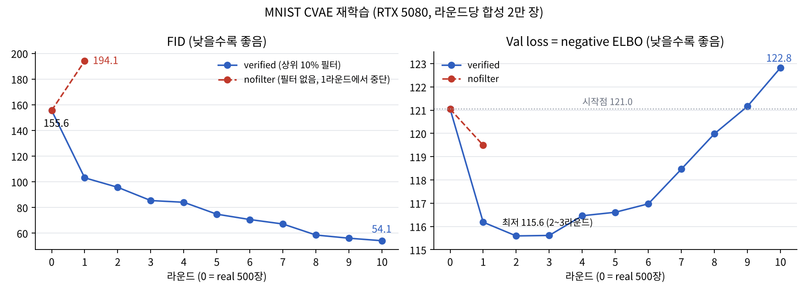

# Escaping Model Collapse via Synthetic Data Verification

- 학회: ICLR 2026
- 논문: https://arxiv.org/abs/2510.16657
- 원본 코드: https://github.com/liuqiyuanhhh/Verified-Synthetic-Data

## 선정 이유

본 프로젝트는 생성 모델이 자기 생성 데이터로 반복 재학습될 때 발생하는 model collapse의 완화 방안을 다룬다. 이에 대한 대표적 접근은 외부 verifier를 통해 합성 데이터를 선별한 뒤 학습에 사용하는 것이다.

본 논문은 verifier 기반 선별이 collapse를 방지할 수 있는지, 그리고 방지 효과의 한계가 어디에 있는지를 이론적 분석과 실험을 통해 규명한다.

또한 구현 코드가 공개되어 있어 결과를 직접 재현하고 프로젝트의 실험 설계로 확장할 수 있다는 점에서 선정하였다.

## 문제의식

Shumailov et al. 2024는 모델이 자기 생성 데이터만으로 재귀적으로 학습될 경우 분포의 꼬리 정보가 소실되며 성능이 퇴화함을 보였다.

반면 실제 응용에서는 합성 데이터를 활용해 성능이 향상되는 사례가 다수 보고되어 왔다.

저자들은 이러한 상반된 관찰의 차이를 합성 데이터가 verifier에 의해 선별되었는지 여부로 설명할 수 있다고 보고, verifier가 재학습 과정에 주입하는 외부 정보가 단기 및 장기 성능에 미치는 영향을 이론적으로 분석한다.

## 방법

저자들은 선형회귀 설정에서 다음 과정을 반복하는 재학습 루프를 분석한다. 먼저 real 데이터로 모델을 추정하고, 추정된 모델로 합성 데이터를 생성한다. 이후 verifier가 각 샘플에 대해 accept 또는 reject를 판정하고, accept된 샘플만으로 모델을 다시 추정한다.

verifier는 참 파라미터가 특정 중심 근방에 존재한다는 사전 지식만을 가진 것으로 모델링된다. 이때 두 가지 요소가 분석의 핵심이 된다.

- verifier bias: verifier가 가진 지식의 중심이 참 파라미터로부터 떨어진 정도
- selectivity: verifier가 샘플을 선별하는 엄격함의 정도

## 핵심 결과

- 단기적 효과: verifier를 통한 선별은 추정량의 variance를 줄여 초기 추정보다 성능을 향상시킨다. 단, 이 효과는 verifier bias가 작고 합성 샘플이 충분할 때에 한해 나타난다.
- 장기적 수렴: 재학습을 반복하면 추정량은 참 파라미터가 아니라 verifier의 knowledge center로 수렴한다.
  - verifier가 unbiased인 경우 참 파라미터로 수렴한다.
  - verifier가 약하게 biased인 경우 초기에는 개선되나 이후 정체되거나 역전된다.
  - verifier가 강하게 biased인 경우 collapse가 발생한다.
  - selectivity는 수렴 지점에는 영향을 주지 않으며 수렴 속도만을 결정한다.

## 논문 실험

- MNIST에 대해 conditional VAE를 사용하였다. real 데이터 500장으로 초기 모델을 학습하고, real 데이터 6만 장으로 학습한 discriminator를 verifier로 사용하여 숫자별 상위 10%의 합성 샘플만을 선별하였다.
- 40회 반복 중 가장 우수한 모델의 FID는 21.17로, real 데이터 6만 장 전체로 학습한 모델의 FID 17.56에 근접하였다.
- verifier 없이 재학습한 경우에는 성능이 크게 퇴화하였다.
- FID는 약 15회까지 개선된 뒤 정체되었고, ELBO는 약 10회 이후 오히려 악화되는 경향을 보였다.
- XSUM 요약 과제에서 SmolLM2-135M을 사용한 실험에서도 같은 경향이 관찰되었다.

## 한계

- 이론적 결과는 선형회귀 설정에서만 증명되었으며, verifier는 accept 또는 reject의 1비트 정보만을 제공한다.
- 이론에서는 verifier가 고정되어 있다고 가정하지만, 실제 구현에서 verifier 역할을 하는 discriminator는 매 반복마다 새로 학습된다.

## 직접 실행 결과

RTX 5080 환경에서 반복당 합성 데이터 2만 장으로 10회 반복 실험을 수행하였다. 논문의 40회보다 짧은 설정이다.



| 반복 | FID ↓ | val loss = negative ELBO ↓ |
| --- | --- | --- |
| 0, real 500장 | 155.6 | 121.0 |
| 1 | 103.1 | 116.2 |
| 2 | 95.7 | 115.6, 최저 |
| 3 | 85.4 | 115.6 |
| 5 | 74.8 | 116.6 |
| 8 | 58.5 | 120.0 |
| 10 | 54.1 | 122.8 |
| 필터 없음, 1회 | 194.1 | 119.5 |

- FID는 10회 동안 지속적으로 개선되어 155.6에서 54.1로 감소하였다. 반면 verifier 없이 재학습한 경우 첫 반복에서 FID가 194.1로 오히려 악화되었다. verifier 없는 실험은 시간 제약으로 1회까지만 수행하였다.
- ELBO는 2~3회에서 가장 우수하였으나 이후 지속적으로 악화되었으며, 9회부터는 초기 모델보다도 낮은 성능을 보였다.
- 해석: 생성 샘플의 sample quality는 향상되지만, 데이터 분포 전체에 대한 coverage는 감소한다. verifier가 real에 가까운 샘플만을 선택하면서 분포가 그 영역으로 집중되는 것으로 볼 수 있으며, 이는 verifier의 knowledge center로 수렴한다는 논문의 결과와 일치하는 방향이다.

## 코드

### 첨부 파일

| 파일 | 내용 |
| --- | --- |
| run_small.py | 실험 스크립트, 반복 횟수와 합성 데이터 수 등을 설정으로 조절 |
| run_both.py | verifier 사용 실험과 verifier 미사용 실험을 차례로 실행 |
| results_verified_10rounds.csv | 위 표의 원본 결과, 반복별 FID, val loss, reconstruction loss, KL |
| verified_vs_nofilter.png | 결과 그래프 |

### 파이프라인 구조

```
real 500장으로 CVAE 학습
반복 1..K:
  A. discriminator 새로 학습: real 6만 장 vs 현재 CVAE가 생성한 합성 6만 장
  B. 숫자별로 생성 → discriminator 점수 상위 10%만 선별 → 목표 수량까지 반복
  C. 새 CVAE를 선별된 합성 데이터로만 학습
  D. val loss, FID 계산 → CSV 저장
```

### 핵심 코드: verifier 필터, src/data_helper.py

```python
samples = model.sample_x_given_y(digit, batch_samples_per_digit)   # 숫자별 샘플 생성
scores = discriminator.score(samples, digit_onehot).squeeze(1)      # 클수록 real에 가까움
threshold = torch.quantile(scores, 1.0 - selection_threshold)       # 0.1이면 상위 10%
filtered_samples = samples[scores >= threshold]
```

## 프로젝트 연결

- 시사점: verifier의 품질이 재학습 성능의 상한을 결정한다. 따라서 여러 verifier를 결합하면 이 상한을 높일 수 있는지가 다음 질문이 된다.
- 본 코드의 generate → verify → retrain 루프를 프로젝트 harness의 기본 구조로 사용한다.
- 단일 discriminator를 여러 모델의 cross-verification으로 구성된 multi-verifier로 대체하여 비교한다.
- 실행 결과에서 FID는 개선되었으나 ELBO는 악화되었으므로, sample quality 지표와 함께 recall 등 diversity 지표도 기록해야 한다.
