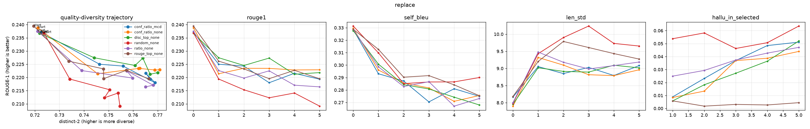
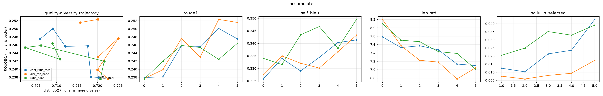
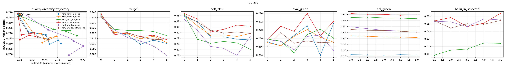
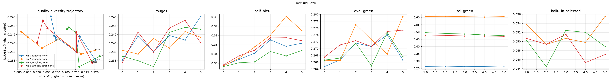

# Proposal 예비 실험 2: XSum 요약에서의 synthetic data selection

## 가설

실험1에서 MNIST로 확인한 conformal gate의 효과가 텍스트 요약에서도 나타나는지 본다. 텍스트에서는 verifier가 걸러야 할 대상이 hallucination으로 분명하다. verifier가 이를 세대가 지나도 계속 걸러내는지, 그리고 verifier가 고른 데이터의 특성이 모델 출력에 나타나는지를 함께 본다.

## 검증 방법

Escaping Model Collapse의 XSum 실험과 같은 SmolLM2-135M-Instruct를 쓴다. 0세대는 real 기사-요약 2,000쌍으로 학습한다. 매 세대 기사 3,000개를 요약하고 그중 25%인 750개를 골라 다시 학습하며, 5세대를 돌린다. 후보의 5%는 다른 기사의 요약으로 바꿔치기해 hallucination을 인위적으로 넣는다.

verifier는 두 종류이다. 하나는 정답 요약과의 ROUGE-1이고, 다른 하나는 (요약, 기사) 쌍이 real인지 생성인지 가르는 discriminator(distilroberta)이다. discriminator는 후보를 둘로 나눠 서로 다른 절반으로 학습하고 점수를 매긴다. 비교한 방법은 random, ROUGE 상위, discriminator 상위, ratio, conformal gate만, conformal gate + MC dropout이다. 매 세대 최신 synthetic 데이터만 쓰는 replace와 real과 이전 데이터를 쌓는 accumulate를 나눠 본다. 성능은 validation 300개의 ROUGE-1로, 다양성은 distinct-2와 self-BLEU로 본다.

Escaping Model Collapse의 XSum 실험과 데이터셋, 모델은 같지만 규모를 줄이고 verifier를 바꿨다.

| 항목 | 우리 실험 | 저자 실험 | 근거 |
| --- | --- | --- | --- |
| 0세대 학습 데이터 | real 2,000쌍 | XSum train의 12.5% (약 2.55만 개) | 논문 Section 5.3, 공식 코드 |
| 세대마다 요약 생성 | 기사 3,000개 | train 전체 기사 | 논문 Section 5.3 |
| 선택 비율 | 25% (750개) | 상위 12.5% (공식 코드는 세대 t마다 12.5% × (1 + t/10)로 증가) | 논문 Section 5.3, 공식 코드 |
| 세대 수 | 5 | 15 | 논문 Figure 5 |
| 평가 | validation 300개 | test ROUGE-1 (공식 코드는 validation 전체 11,332개) | 논문 Section 5.3, 공식 코드 |
| verifier | ROUGE, discriminator, ratio, conformal gate 등 | 정답과의 ROUGE-1 (oracle) vs random | 논문 Section 5.3 |
| hallucination 주입 | 후보의 5% | 없음 | |

seed 3개로 반복했고, 표의 값은 평균 ± 표준편차이다. 코드는 `code/`, 결과 원본은 `results_3seeds/`에 있다. seed 0만 돌린 첫 결과는 `results_seed0/`에 남겨 둔다.

## 결과

5세대 시점 값이다. 0세대 ROUGE-1은 0.234~0.243이고, 후보 전체의 hallucination 비율은 0.05이다.

| 방식 | 방법 | ROUGE-1 ↑ | distinct-2 ↑ | self-BLEU ↓ | 선택된 데이터의 hallucination |
| --- | --- | --- | --- | --- | --- |
| replace | random | 0.209 ± 0.004 | 0.755 ± 0.004 | 0.290 ± 0.007 | 0.064 ± 0.002 |
| replace | ROUGE 상위 | 0.220 ± 0.006 | 0.766 ± 0.004 | 0.275 ± 0.007 | 0.004 ± 0.001 |
| replace | discriminator 상위 | 0.222 ± 0.007 | 0.770 ± 0.002 | 0.268 ± 0.003 | 0.052 ± 0.008 |
| replace | ratio | 0.216 ± 0.006 | 0.765 ± 0.000 | 0.273 ± 0.005 | 0.047 ± 0.004 |
| replace | conformal gate | 0.223 ± 0.010 | 0.771 ± 0.008 | 0.276 ± 0.018 | 0.044 ± 0.006 |
| replace | conformal gate + MC dropout | 0.219 ± 0.005 | 0.767 ± 0.002 | 0.275 ± 0.003 | 0.051 ± 0.004 |
| accumulate | discriminator 상위 | 0.252 ± 0.002 | 0.716 ± 0.004 | 0.343 ± 0.004 | 0.017 ± 0.017 |
| accumulate | ratio | 0.246 ± 0.001 | 0.709 ± 0.005 | 0.350 ± 0.007 | 0.039 ± 0.008 |
| accumulate | conformal gate + MC dropout | 0.248 ± 0.004 | 0.706 ± 0.005 | 0.341 ± 0.007 | 0.043 ± 0.005 |





replace에서는 모든 방법의 ROUGE-1이 1세대에 0.219~0.227로 떨어졌다. 5세대에는 verifier를 쓴 방법이 0.216~0.223, random이 0.209로, 다섯 verifier의 평균이 모두 random보다 0.007~0.014 높았다. 다만 seed 2에서는 ratio와 conformal gate가 random보다 낮아, seed 3개로는 차이가 확정적이지 않다. 1세대의 하락에는 학습 데이터가 real 2,000쌍에서 synthetic 750쌍으로 바뀐 효과가 섞여 있을 수 있다.

replace의 다양성 지표는 0세대 대비 5세대에 오히려 좋아졌다. 6개 방법 평균으로 distinct-2가 0.72에서 0.77로 오르고 self-BLEU가 0.33에서 0.28로 내려갔다. 5세대 안에서는 다양성 감소 없이 ROUGE-1만 저하되었다.

accumulate에서는 ROUGE-1이 0.246~0.252로 0세대보다 올랐지만, self-BLEU가 0.33에서 0.34~0.35로 오르고 distinct-2가 0.72에서 0.71~0.72로 내려갔다. 성능은 오르는 대신 출력끼리 비슷해졌다.

verifier를 쓴 방법끼리의 ROUGE-1 차이는 replace에서 최대 0.006으로 seed 표준편차(0.005~0.010)와 비슷한 크기이고, accumulate에서는 최대 0.005로 discriminator 상위가 표준편차(0.001~0.004)보다 크게 높았다. 어느 방식에서도 conformal gate가 다른 verifier보다 낫다는 근거는 없었다.

verifier가 고른 데이터에서는 다음이 관찰된다.

- **replace에서 discriminator 계열 verifier는 세대가 지날수록 hallucination을 덜 걸러낸다.** 선택된 데이터의 hallucination 비율(seed 평균)은 1세대 0.006~0.025에서 5세대 0.044~0.052로 올라, 후보 전체 비율(0.05)에 가까워졌다. accumulate의 discriminator 상위는 5세대에도 0.017이었다. 생성 모델이 바뀌면서 discriminator가 내용의 일치보다 문체 단서에 의존하게 된 것으로 추정되나, 이 지표만으로는 확인할 수 없다.
- **정답을 참조하는 ROUGE verifier는 hallucination 비율을 가장 낮게 유지했다.** 1~5세대 모두 0.006 이하였으나, ROUGE-1은 discriminator 계열과 비슷했다.
- **verifier마다 고르는 요약 길이가 다르다.** random이 고른 요약(후보 길이의 대용값, 약 30단어) 대비 ROUGE verifier는 긴 요약(31.5~31.9단어)을, discriminator 계열은 짧은 요약(24.5~26.4단어)을 선택했다. ROUGE 상위로 학습한 모델의 출력은 26.1단어에서 27.5단어로 세 seed 모두 길어졌으나, discriminator 계열 replace에서는 출력 길이 변화의 방향이 seed마다 달랐다.

## 정리

- 텍스트에서는 verifier를 쓴 방법의 평균 ROUGE-1이 모두 random보다 높았지만, seed 3개로는 차이가 확정적이지 않다. conformal gate의 이점은 확인되지 않았다.
- replace에서 discriminator 계열이 고른 데이터의 hallucination 비율은 세대마다 높아졌다. verifier를 매 세대 held-out real 데이터로 보정하는 방향을 proposal에서 검토할 근거가 된다.
- 이 실험은 calibration과 평가가 모두 XSum에서 나온 데이터라, reference와 test가 같은 분포인 설정이다. 둘의 분포가 다른 경우(예: 일부 주제로 calibration하고 다른 주제로 평가)는 아직 확인하지 않았다.
- discriminator가 hallucination을 덜 걸러내게 되는 원인과, verifier의 길이 선호가 모델로 전이되는지는 아직 확인되지 않았다. 선택 데이터의 길이만 바꾼 대조 실험과 discriminator의 판단 근거 분석이 필요하다.

## 워터마크 실험 (RQ2)

### 가설

AI 생성 텍스트를 식별하기 위한 watermark는 생성 과정에서 특정 토큰의 선택 확률을 높이므로 생성 분포를 조금 바꾼다. watermark가 들어간 synthetic 데이터로 반복 학습하면 이 변화가 누적되어 출력의 다양성이 줄어드는지 본다. 또한 watermark 검출 점수를 데이터 선택 기준으로 썼을 때 다양성이 유지되는지 본다.

### 검증 방법

Kirchenbauer et al.(2023)의 green list 방식(KGW)을 직접 구현했다. 직전 토큰으로 vocabulary의 25%(γ = 0.25)를 green list로 정하고, synthetic 요약을 생성할 때 green 토큰의 logit에 δ를 더한다. 평가용 요약은 watermark 없이 생성하므로, 평가 출력의 green 비율(eval_green)이 오르면 모델이 watermark 패턴을 학습한 것이다. 이 tokenizer와 hash에서 watermark가 없을 때의 green 비율은 0.26~0.27이다.

나머지 설정은 위 실험과 같다(0세대 real 2,000쌍, 세대마다 후보 3,000개 중 750개 선택, 5세대, hallucination 5% 주입, seed 3개). 선택 방법은 다음 네 가지이다.

| 방법 | 설명 |
| --- | --- |
| random | 무작위 선택 |
| wm_low | watermark z-score가 낮은 순으로 선택 |
| wm_low_strat | 후보를 길이 기준 10개 구간으로 나누고, 구간마다 z-score가 낮은 요약을 구간 크기에 비례해 선택. 선택된 데이터의 길이 분포가 후보 전체와 같아진다 |
| discriminator 상위 | 위 실험의 discriminator verifier |

wm_low_strat을 둔 이유는 z-score가 같은 green 비율에서도 짧은 텍스트일수록 작게 나와, wm_low가 watermark가 약한 요약보다 짧은 요약을 고를 수 있기 때문이다.

### 결과

5세대 시점, 3 seed 평균 ± 표준편차이다. 길이는 평균 단어 수이다.

**replace**

| δ | 방법 | ROUGE-1 ↑ | distinct-2 ↑ | self-BLEU ↓ | 출력 길이 | 선택 데이터 길이 | 선택 데이터의 green 비율 |
| --- | --- | --- | --- | --- | --- | --- | --- |
| 0 | random | 0.210 ± 0.004 | 0.753 ± 0.010 | 0.287 ± 0.007 | 26.6 | 30.0 | 0.262 |
| 1 | random | 0.211 ± 0.002 | 0.738 ± 0.014 | 0.298 ± 0.002 | 27.4 | 31.3 | 0.407 |
| 2 | random | 0.214 ± 0.002 | 0.720 ± 0.002 | 0.311 ± 0.012 | 29.8 | 34.6 | 0.597 |
| 2 | wm_low | 0.199 ± 0.003 | 0.759 ± 0.003 | 0.293 ± 0.003 | 21.3 | 17.7 | 0.462 |
| 2 | wm_low_strat | 0.214 ± 0.004 | 0.743 ± 0.006 | 0.298 ± 0.007 | 29.1 | 32.2 | 0.452 |
| 2 | discriminator 상위 | 0.218 ± 0.001 | 0.765 ± 0.009 | 0.271 ± 0.009 | 25.3 | 25.6 | 0.565 |

**accumulate**

| δ | 방법 | ROUGE-1 ↑ | distinct-2 ↑ | self-BLEU ↓ | 출력 길이 | 선택 데이터 길이 | 선택 데이터의 green 비율 |
| --- | --- | --- | --- | --- | --- | --- | --- |
| 0 | random | 0.246 ± 0.005 | 0.697 ± 0.002 | 0.352 ± 0.006 | 25.2 | 28.0 | 0.266 |
| 2 | random | 0.241 ± 0.004 | 0.685 ± 0.005 | 0.365 ± 0.012 | 26.0 | 29.8 | 0.605 |
| 2 | wm_low | 0.243 ± 0.003 | 0.706 ± 0.008 | 0.344 ± 0.011 | 22.1 | 19.7 | 0.474 |
| 2 | wm_low_strat | 0.240 ± 0.005 | 0.690 ± 0.004 | 0.354 ± 0.012 | 25.9 | 28.5 | 0.469 |





**watermark가 다양성에 미치는 영향**

- **replace에서는 watermark 강도가 클수록 다양성이 줄었다.** random 선택에서 δ가 0, 1, 2로 커지면 distinct-2는 0.753, 0.738, 0.720으로 낮아지고 self-BLEU는 0.287, 0.298, 0.311로 높아졌다. δ = 0과 δ = 2의 distinct-2 차이 0.033은 표준편차의 약 3배이다. ROUGE-1은 떨어지지 않았다.
- **accumulate에서도 같은 방향이지만 감소 폭이 작다.** δ = 0에서 δ = 2로 바뀌면 distinct-2가 0.697에서 0.685로 0.012 낮아졌다(큰 쪽 표준편차의 약 2.4배). self-BLEU 차이는 표준편차 수준이다. real 데이터가 계속 남아 있어 watermark의 영향이 희석된 것으로 보인다.
- **watermark 자체는 학습된 모델에서 검출되지 않았다.** eval_green은 replace의 모든 δ에서 0.27 근처로 watermark가 없을 때와 같았다. accumulate의 δ = 2에서는 0.279로 δ = 0(0.267)보다 조금 높았지만, 검출 기준에는 한참 못 미친다. 정리하면 watermark는 검출되지 않을 만큼 옅어진 채로 다양성만 줄었다.

**길이 효과의 분리**

- δ = 2에서는 생성 요약이 길어져(출력 26.6 → 29.8단어), 다양성 감소의 일부가 길이 증가 때문일 수 있었다. replace 조건에서 출력 길이와 distinct-2의 상관은 −0.76이다.
- wm_low_strat은 출력 길이가 29.1단어로 δ = 2 random(29.8단어)과 비슷하지만, distinct-2는 0.743으로 δ = 2 random보다 0.023 높고(표준편차의 약 4배) δ = 0(0.753)에 가깝다. ROUGE-1도 0.214로 같다. 따라서 replace에서의 다양성 감소는 길이만으로 설명되지 않으며, watermark가 강한 요약을 학습에 쓴 것이 원인의 일부이다.
- 길이를 통제하지 않은 wm_low는 짧은 요약(17.7~19.7단어)을 골라 다양성은 높았지만, replace에서 ROUGE-1이 0.199로 가장 낮았다.

**watermark 검출을 verifier로 쓰는 효과**

- **replace에서는 효과가 있었다.** 길이를 맞춘 wm_low_strat은 ROUGE-1을 유지한 채 watermark로 생긴 distinct-2 감소(0.033)의 약 2/3를 회복했다.
- **accumulate에서는 효과가 불분명하다.** wm_low_strat의 distinct-2는 0.690으로 δ = 2 random(0.685)과 δ = 0(0.697)의 사이였고, 차이는 표준편차 수준이었다. wm_low의 다양성 이점(0.706)은 짧은 요약을 고른 효과가 대부분이다.
- **discriminator 상위는 replace 조건 중 ROUGE-1과 다양성이 가장 높았다.** 선택된 데이터의 hallucination 비율도 0.024로, watermark 없이 같은 방법을 쓴 위 실험(0.052)보다 낮았다. watermark 때문에 생성 텍스트가 real과 더 잘 구분되었을 가능성이 있으나, 이 실험만으로는 확인할 수 없다.

### 정리

- watermark가 들어간 synthetic 데이터로 반복 학습하면, watermark는 검출되지 않을 만큼 옅어지지만 출력 다양성은 줄어든다. 감소는 replace에서 뚜렷하고 accumulate에서는 작다.
- 이 감소는 길이 변화만으로 설명되지 않는다. 길이를 맞춘 상태에서 watermark가 약한 요약을 고르면 replace에서 다양성이 상당 부분 회복되었다.
- watermark 검출 점수를 verifier로 쓸 때는 길이 보정이 필요하다. 보정하지 않으면 짧은 요약을 고르는 효과가 섞인다.
- 규모(5세대, 2,000쌍)와 seed 수(3개)가 작아, accumulate에서의 효과는 더 긴 세대와 더 많은 seed로 확인해야 한다.

## 실행

```powershell
py run_all_text.py --quick         # 시간 측정용, 1세대
py run_all_text.py                 # seed 0, 9개 run
py run_all_text.py --seeds 1 2     # seed 1, 2 추가
py plot_results.py text_runs --text

py run_all_text.py --wm --seeds 0 1 2   # watermark 실험, text_runs_wm에 저장
py plot_results.py text_runs_wm --text
```
