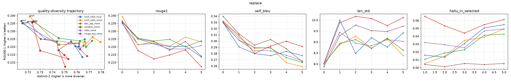
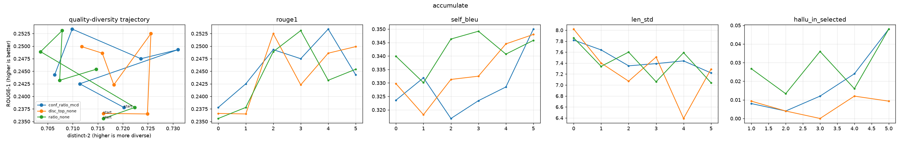

# Proposal 예비 실험 2: XSum 요약에서의 synthetic data selection

## 가설

실험1에서 MNIST로 확인한 conformal gate의 효과가 텍스트 요약에서도 나타나는지 본다. 텍스트에서는 verifier가 걸러야 할 대상이 분명하다. 그럴듯하지만 기사와 맞지 않는 요약, 즉 hallucination이다. verifier가 이를 계속 걸러내는지, 그리고 verifier의 기준이 반복 학습에서 모델에 어떻게 옮겨 가는지를 함께 본다.

## 검증 방법

Escaping Model Collapse의 XSum 실험과 같은 SmolLM2-135M-Instruct를 쓴다. 0세대는 real 기사-요약 2,000쌍으로 학습한다. 매 세대 기사 3,000개를 요약하고 그중 25%인 750개를 골라 다시 학습하며, 5세대를 돌린다. 후보의 5%는 다른 기사의 요약으로 바꿔치기해 hallucination을 인위적으로 넣는다.

verifier는 두 종류이다. 하나는 정답 요약과의 ROUGE-1이고, 다른 하나는 (요약, 기사) 쌍이 real인지 생성인지 가르는 discriminator(distilroberta)이다. discriminator는 후보를 둘로 나눠 서로 다른 절반으로 학습하고 점수를 매긴다. 비교한 방법은 random, ROUGE 상위, discriminator 상위, ratio, conformal gate만, conformal gate + MC dropout이다. 매 세대 최신 synthetic 데이터만 쓰는 replace와 real과 이전 데이터를 쌓는 accumulate를 나눠 본다. 품질은 validation 300개의 ROUGE-1로, 다양성은 distinct-2와 self-BLEU로 본다.

seed는 아직 1개이다. 코드는 `code/`에 있고, 결과 원본은 `results_seed0/`에 있다.

## 결과

5세대 시점 값이다. 0세대 ROUGE-1은 0.235~0.240이고, hallucination 비율은 후보 전체에서 0.05이다.

| 방식 | 방법 | ROUGE-1 ↑ | 선택된 데이터의 hallucination (1세대 → 5세대) | 선택된 요약 길이 |
| --- | --- | --- | --- | --- |
| replace | random | 0.207 | 0.065 → 0.061 | 약 30단어 |
| replace | ROUGE 상위 | 0.214 | 0.004 → 0.005 | 29~31단어 |
| replace | discriminator 상위 | 0.224 | 0.011 → 0.043 | 약 25단어 |
| replace | ratio | 0.221 | 0.032 → 0.049 | 약 26단어 |
| replace | conformal gate | 0.223 | 0.005 → 0.049 | 약 25단어 |
| replace | conformal gate + MC dropout | 0.214 | 0.016 → 0.055 | 약 25단어 |
| accumulate | discriminator 상위 | 0.250 | 0.009 → 0.009 | 약 25단어 |
| accumulate | ratio | 0.245 | 0.027 → 0.048 | 약 26단어 |
| accumulate | conformal gate + MC dropout | 0.244 | 0.008 → 0.048 | 약 25단어 |





replace에서는 모든 방법의 ROUGE-1이 1세대에 0.22 근처로 떨어진다. 이후 verifier를 쓴 방법은 0.22 근처에서 거의 평평했고, random만 0.207까지 계속 내려갔다. 다만 1세대의 하락에는 학습 데이터가 real 2,000쌍에서 synthetic 750쌍으로 줄어든 효과가 섞여 있다. accumulate에서는 ROUGE-1이 0.244~0.250으로 오히려 올랐지만, self-BLEU가 0.32에서 0.35로 올라 출력끼리 비슷해졌다.

방법 간 ROUGE-1 차이는 0.01 안팎으로 세대별 흔들림과 비슷한 크기라, 실험1과 달리 conformal gate가 다른 verifier보다 낫다는 근거는 없었다.

대신 verifier의 기준이 반복 학습에서 변하거나 모델에 옮겨 가는 모습이 보인다.

- **discriminator는 세대가 지날수록 hallucination을 못 거른다.** 1세대에는 선택된 데이터의 hallucination 비율을 후보 전체의 1/3~1/10로 줄였지만, 5세대에는 0.043~0.055로 거의 걸러지지 않는다. 생성 모델이 바뀌면서 discriminator가 기사와 요약이 맞는지보다 문체 같은 단서로 real과 생성을 가르게 된 것으로 추정한다. accumulate의 discriminator 상위만 5세대까지 낮게 유지됐다.
- **ROUGE verifier는 길이 bias를 모델에 옮긴다.** 정답 요약을 직접 보는 강한 verifier인데도 긴 요약을 골랐고(29~31단어), 이를 학습한 모델의 출력도 27~29단어로 길어졌다. ROUGE-1은 discriminator 계열보다 낮았다.

## 정리

- 텍스트에서는 conformal gate의 이점이 확인되지 않는다. seed 1개 기준이라 seed를 늘려 다시 확인할 예정이다.
- verifier의 판단 기준은 생성 모델이 바뀌면 함께 변하고, 그 bias는 반복 학습을 거쳐 모델에 쌓인다. 이는 verifier를 매 세대 held-out real 데이터로 보정해야 한다는 우리 proposal의 동기를 뒷받침한다.
- discriminator가 hallucination을 거르는 능력을 잃는 원인은 아직 추정이다. discriminator가 무엇을 보고 판단하는지 분석이 필요하다.

## 실행

```powershell
py run_all_text.py --quick         # 시간 측정용, 1세대
py run_all_text.py                 # seed 0, 9개 run
py run_all_text.py --seeds 1 2     # seed 1, 2 추가
py plot_results.py text_runs --text
```
